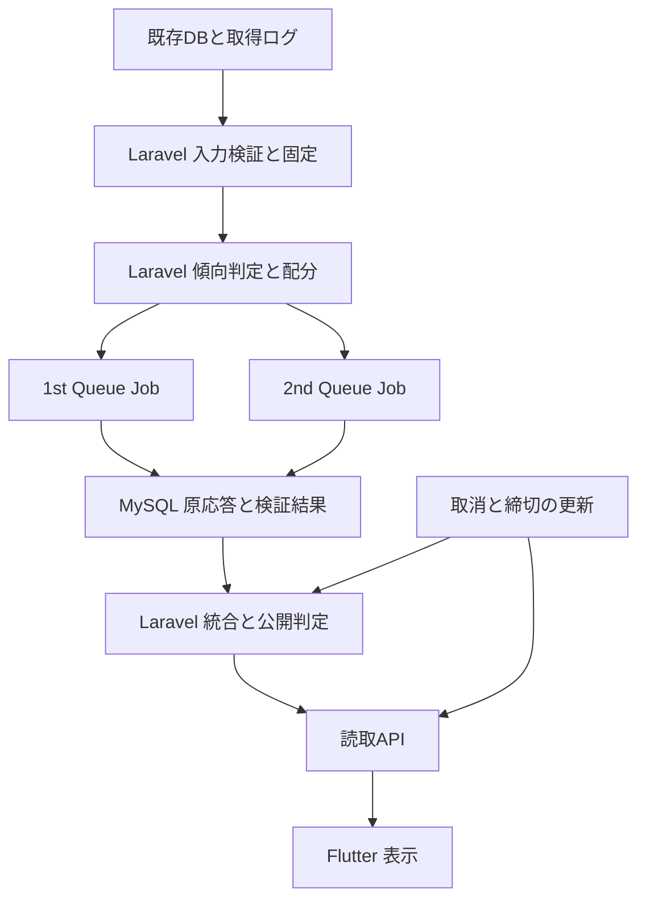

# 馬眼力 基本設計書

文書版：1.3  
作成日：2026年10月19日（文書版1.0）  
更新日：2026年10月20日（文書版1.1・実装担当が追記）  
更新日：2026年10月21日（文書版1.2・実装担当が追記と差替え）  
更新日：2026年10月21日（文書版1.3・10月21日008のご指摘を反映。取り下げた説明を整理）  
対象：2026年10月24日・25日の導入を目標とする r12.2  
実装構成：Laravel＋Flutter、既存MySQL、Laravel Queue

> **文書版1.2の変更のしかたについて（10月20日006のご指摘7への回答）**
>
> 前回「追記以外は1文字も変更していない」と書きましたが、厳密には違いました。
> 版表示には差替えがありました。申し訳ありません。今回は**追記と差替えを分けて**書きます。
>
> | 印 | 意味 |
> |---|---|
> | 【実装追記 2026-10-20】 | 文書版1.1で足した段落。中身は変えていない |
> | 【実装追記 2026-10-21】 | 文書版1.2で新しく足した段落 |
> | 【差替え 2026-10-21】 | 文書版1.1の追記のうち、現物と合わなくなったので書き直した段落。差替え前の文もその場に残す |
> | 【実装追記 2026-10-21b】 | 文書版1.3で新しく足した段落 |
> | 【取り下げ 2026-10-21b】 | 文書版1.2で書いた説明のうち、10月21日008のご指摘を受けて取り下げた段落。取り下げ前の文もその場に残す |
>
> 差替えたのは**すべて文書版1.1で実装担当が足した「実装追記」の段落だけ**です。
> 文書版1.0の本文（正本の仕様）は、版表示を除いて1文字も変えていません。
> 採用方針①〜③も再選択していません。差替えの一覧は別紙
> `06_設計書の差替え箇所と追記箇所.md` にまとめました。
>
> 追記した箇所は、対応する**関数名・アンカー注釈・試験ID**を必ず添えてあります。
> 添えられないものはいまも「未実装」「未測定」と書いています。

## 1 目的と採用方針

レース傾向に応じた人気帯別配分を守り、確認できる根拠を持つ人気薄を候補に残す経路を実装する。サーバー側で判定・配分・検証・保存・公開を完結させ、Flutterは検証済みの結果と現在の取消状態を表示する。

| 確認事項 | 今回採用する仕様 |
| --- | --- |
| ① X6 | **Bを採用**。過去類似成績によるX6は当面使用しない。既存仕様書9章の例外として暫定選出を許可する。N≧7ではX6=null、N＜7では既存定義のfalseを維持する。 |
| ② オッズ取得期限 | **6分前は予定時刻＋30秒、21・18・15・12・9分前は＋120秒**。発走時刻を基準とし、実際に受信・保存され利用可能になった時刻で検査する。 |
| ③ 暫定配分 | 不明信号がX6だけでmodeが一意にならない場合、**S0＝1はMIXED相当、S0＝3はVOLATILE相当**。正式modeはUNKNOWN、表示は暫定とする。 |
| 実装方式 | **Laravel＋Flutter**。追加の実行言語や外部計算プロセスを導入条件にしない。 |

暫定配分は選出方法の指定であり、レースが実際に混戦・波乱になると確定した意味ではない。判定不能だった33レースは暫定選出の対象になるが、入力不正・根拠不足・AI不正応答・期限超過は個別に検査する。

【実装追記 2026-10-20】**投票締切の正本**。DBに投票締切の列は存在しなかった。JRA公式「発売時間・発売締切時刻」の「当日発売のインターネット投票は各レース発走時刻の1分前」を正本とし、発走時刻Tから `sales_close_at = T − 60秒` として導出する。発走時刻と同一視しない。ここから `publish_deadline = T − 120秒`、`reply_deadline = T − 150秒`、`input_freeze_at = T − 330秒`、名目cutoff `T − 360秒` が並び、AIに使える時間は180秒になる。関数は `BaganrikiTime::salesCloseFromPost()`、出どころの名前は `JRA_INTERNET_1MIN_BEFORE_POST`、前倒し秒数は `.env` の `BAGANRIKI_SALES_CLOSE_OFFSET_SEC`（既定60）。試験 R122-CL01〜CL08。

【実装追記 2026-10-20】**未解決事項**。公式表記は「1分前」で**秒の記載がない**。`T − 60秒` ちょうどとするか、発走時刻の分の0秒（最大59秒の前倒し）とするかは**仕様としてのご判断をお願いしたい**。後者を採ると、AIに使える時間が最大121秒まで縮む。導出の根拠と締切の値は、凍結と同じトランザクションで監査イベント（規則名・URL・前倒し秒数・締切・発走時刻）に残している。

## 2 文書の役割と優先順位

| 文書 | 役割 |
| --- | --- |
| 変更計画書 文書版1.2 | 採用方針、変更範囲、工程、受入条件、33レースの配分表 |
| 本書 | システム構成、機能分担、処理の流れ、画面と運用の方針 |
| 詳細設計書 文書版1.0 | 項目、時刻式、判定手順、保存と競合、API、試験ケース |
| 既存r12.1仕様とプロンプト | 今回変更しない根拠・採点・局所訂正・順位・監査の契約 |

今回の実装構成・X6暫定規則・時刻契約・追加項目はこの文書セットを適用する。他の既存動作を独自に簡略化しない。旧版の保存済みsnapshotや応答は旧版のまま保持する。

本書は実装設計であり、実装完了報告ではない。詳細設計のクラス・新規テーブル名は今回の指定名で、既存システムに実在するとの意味ではない。既存DB列、サービス登録、キュー接続、認証方式、実AIの設定との対応は開発担当者が実コードで確認して記録する。

## 3 対象範囲

### 3.1 今回実装するもの

- 対象レース一覧を起点とする出馬表・オッズ・取消・締切の読込。
- 実取得時刻の監査と入力固定、X1〜X6・Zの判定、暫定配分。
- 人気帯配分と両AIの全頭独立評価、原応答保存、必要時の訂正。
- 根拠・採点・順位・候補の検証、保存済み応答からの統合。
- 取消と締切前倒し、期限内公開、公開後の取消表示。
- Flutter向け読取API、履歴、障害診断、取得データの保存。

### 3.2 今回有効にしないもの

| 機能 | 今回の扱い |
| --- | --- |
| X6の実履歴判定 | 未使用。定義・母数50件の数え方・検証・切替条件を別改訂で確定する。 |
| 学習による自動変更 | `learning_stage=COLLECT_ONLY`、`model_version=null`。記録を継続する。 |
| 購入推奨 | `buy_recommended=false`、`PENDING_VALIDATION`。公開候補の削除条件にはしない。 |
| 的中率・回収率の向上認定 | 今回の技術受入と区別し、開催後の照合で評価する。 |

【実装追記 2026-10-20】**段階導入のための中間段（shadow）を追加した**。旗を1にした瞬間に、r12.2の入力が組めないレースで商品の予想が止まる。初日にそれを避けるため、本文の旗を3段にした。

| `BAGANRIKI_R122_PROMPT` | 動き |
| --- | --- |
| `0` | 旧本文のまま。r12.2の経路に入らない。 |
| `shadow` | **r12.2の入力を組み立てて凍結保存し、大きさ・coverage・取得監査の紐づきを記録する。AIへ送る本文は旧版のまま。商品の予想は落ちない。** |
| `1` | r12.2の本文で実送信する。入力が組めないレースは予想が止まる。 |

shadow段はキューの枠を取らない（旧本文の応答でジャーナルを汚さないため）。例外を外に出さない。関数は `BaganrikiPrompt::mode()` / `sending()` と `r122ShadowRecord()`。試験 S-01〜S-05、S-12〜S-14。**10月24日・25日はこのshadow段で動かすことを提案する**（第8章の追記を参照）。

## 4 全体構成

1stと2ndには同一snapshotを渡す。相手の回答や選出馬を入力に混ぜず、2ndも全N頭を評価する。AIへの外部通信中にDBの書込ロックを保持しない。

| 層 | 責務 |
| --- | --- |
| Laravelの入力層 | 正本の照合、取得期限、重複・欠損・取消矛盾、出典とcoverage |
| Laravelの計算層 | 正確な数値比較、信号、mode、配分、根拠検証、順位、局所回復 |
| Laravel Queue | 役割別AI呼出し、永続予約、訂正上限、統合の再実行 |
| MySQL | 凍結入力、取得監査、呼出枠、原応答、ライブ状態、公開履歴 |
| 読取API | 正式公開と現在状態の分離、表示用DTO、認証・認可 |
| Flutter | 暫定・不足・取消の表示。配分や候補の再計算はしない。 |

## 5 処理の流れ

### 5.1 入力の読込と固定

対象日とレース一覧を正本から確定する。出馬表やオッズが欠けてもレースを集計から落とさず、計算不能の理由を残す。宣言頭数、出馬表の馬番集合、取得したオッズの馬番集合を独立に照合する。

発走時刻をTとして、名目cutoffはT−360秒、入力の情報上限はT−330秒。6分前単勝は全活動馬分を同じ採用バッチで確保する。それ以外の欠損を理由に正常な馬を一律除外しない。

固定前に利用可能になった取消は出走集合へ反映する。固定後はsnapshot、順位、人気帯、信号、正式mode、配分用modeを変更せず、ライブ状態だけを更新する。

【実装追記 2026-10-20】**実取得監査からの読込で3点を直した**（10月20日005のご指摘2。3件とも本物の不具合だった）。

| 直した内容 | 場所 |
| --- | --- |
| DBの `DATETIME(6)` をマイクロ秒を保ったままRFC3339へ変換する。**外部入力の日時検査は緩めず**、DBとの変換だけを別関数にした。 | `r122DbTime()` / `BaganrikiWorker::dbUs()` |
| 情報上限を**正本の発走時刻から算出して**採用判定へ渡す。バッチの自己申告は使わない。 | `r122GatherContext()` |
| **採用バッチの原ペイロードから値を復元して使う。**共通のオッズテーブルからは読まない。取消情報も採用バッチのものを使う。 | `$cells = $batchCells;`（`@ANCHOR-20261020-R122-ACQFIX`） |

【実装追記 2026-10-20】**「形の検査」と「正本との意味的一致の検査」を分けた**。発走時刻が渡されているとき、申告された `slot_scheduled_at` が正本から出した予定と合わなければ `SCHEDULE_MISMATCH`、申告された `input_freeze_at` が正本から出した情報上限と合わなければ `FREEZE_MISMATCH` で不採用にする。理由文には申告値と正本値の両方を書く（発走時刻が変更されたレースで何がずれたのか追えるようにするため）。`@ANCHOR-20261020-R122-ANCHORMATCH`、試験 N-05〜N-07。

【実装追記 2026-10-20】**存在しない日付・時刻を受け取らないようにした**。`DateTimeImmutable::createFromFormat` は `2026-02-30` を3月2日へ、`25:00` を翌日01:00へ**繰り上げて `false` を返さない**。作り直した日付・時刻を元の文字列と突き合わせ、あわせて警告・注意も見る。`@ANCHOR-20261020-R122-ROLLOVER`、試験 N-08〜N-14。

### 5.2 傾向と配分

通常の三値論理で可能なmodeが一つなら、そのmodeを採用する。複数modeにまたがり、不明がX6だけなら指定の暫定配分を使う。他の不明が原因でmodeがまたがる場合には例外を広げない。

人気帯は凍結単勝順位でA＝1〜6、B＝7〜10、D＝11以下。目標頭数はN＝1〜3ならN、4〜8なら4、9〜13なら5、14〜15なら6、16〜18なら7。配分の全表と不足時の順序は詳細設計書に固定する。

確認済み個別SIGNALが1系統ある馬を、旧資格・低配当・回収率・部分欠損だけで落とさない。有効な馬が帯内に足りれば指定枠を満たす。根拠が無い馬を数合わせで追加しない。

【実装追記 2026-10-20】**取消後は、最新の頭数から目標頭数と基本配分を引き直す**（10月20日005のご指摘4。本物の不具合だった。従来は旧配分の不足移動しかしていなかった）。**凍結帯は維持し、人気は繰り上げない。**引き直すのは目標頭数と基本配分だけである。`afterCancellation()`（`@ANCHOR-20261020-R122-RECALC`）、試験 N-15〜N-29。

| 例 | 取消前 | 取消後の目標頭数 | 取消後の基本配分 |
| --- | --- | --- | --- |
| 16→15頭 | 7／3-3-1 | 6 | 3/2/1 |
| 14→13頭 | 6／3-2-1 | 5 | 3/2/0 |
| 9→8頭 | 5／3-2-0 | 4 | 2/2/0 |
| 全頭取消 | 7／3-3-1 | 0 | 枠を返さない（`all_cancelled=true`。旧配分を返さない） |

【実装追記 2026-10-20】**Zの判定で丸めた値を使っていた**（10月20日005のご指摘3。本物の不具合だった）。X1〜X5は元値のたすき掛けに置き換えていたが、**Zだけ `round(…,4)` した表示用の値を見ていた**。そのため 19.9999÷10＝1.99999 が 2.0000 に丸められ、16頭の例で混戦3/3/1が堅い5/2/0に変わっていた。元値のたすき掛けへ直し、ご指定の16頭を元値→ペア→全信号→mode→配分まで通した（`@ANCHOR-20261020-R122-Z`、試験 R122-Z01・22項目）。同じ入力で「4桁に丸めると 2.0000 になる」ことも試験に入れ、丸めが戻れば試験が落ちるようにした。

### 5.3 AIと統合

役割ごとに初回1回、必要な訂正1回まで、合計最大4呼出し。予約を永続保存してから外部APIへ送る。結果不明の呼出枠を再発行しない。

原応答の正常部分を保存し、不正箇所だけを隔離・訂正する。統合は保存済みの全適格馬順位を利用し、片側だけ有効でも期限内なら公開できる。正常な候補を旧候補フィルターへ戻さない。

【実装追記 2026-10-20】**判定を1か所に集めた**。`BaganrikiDiagnose::run()` が `repair_scope`・`row_valid`・`findings` を返し、**検証（inspect）と訂正（resolve）が同じ関数を使う**。片方だけ直って食い違う事故を防ぐためである。公開リスト・公開フラグの不一致では評価行（horses）を広げない（試験 R-12〜R-14）。欠落した実在馬は、凍結runner集合に居てhorses訂正対象内であれば救済し、凍結集合に居ない馬は未知馬として隔離する（試験 R-05・R-06・R-16・R-17）。正規応答のキーは `horse_no` を優先して読む（`@ANCHOR-20261020-R122-HORSENO`）。

【実装追記 2026-10-20】**証明がなければ加点しない**（10月20日005のご指摘5-2。本物の不具合だった）。両roleの原公開が一致した馬への +5 は、**その証明がそろっているときだけ**出す。証明は「1本の完全な原応答が、公開に使う全頭とそろっているときだけ」出す（`r122ResponseUsed()`）。混ざった行・片側不適合では出さない。加点の証明hashは各馬の事実出典hashとは別に残す。試験 R122-R03、P-06〜P-08・P-17。

【実装追記 2026-10-20】**AIを待つ時間を応答期限から決める**。固定の90秒／240秒をやめ、`reply_deadline` から逆算する（5秒残す・下限20秒・上限170秒）。`r122AiTimeout()`、試験 S-06〜S-11。

### 5.4 公開と取消

公開期限は確認済み投票締切の60秒前、AI受領期限は公開期限の30秒前。取得猶予とは別に検査する。締切が前倒しされた場合は早い方を使い、延長で猶予を増やさない。

期限前の取消は保存済み全頭評価から再統合できる。期限後は取消表示だけを更新し、正式公開候補を追加・補充・入替しない。

## 6 画面とAPI

| 表示状態 | Flutterの表示 |
| --- | --- |
| CONFIRMED | 確定した傾向と候補。星は既存条件で確定できる場合だけ表示。 |
| PROVISIONAL | 「混戦として暫定選出」または「波乱として暫定選出」。過去類似判定が未確定と補足。星は表示しない。 |
| UNRESOLVED | 判定不能と理由。堅いレースへ読み替えない。 |
| 入力不足・期限超過 | 見送りと理由。候補を生成するための自動再取得・再AI送信を画面から行わない。 |
| 取消 | 正式公開時の履歴を残し、現在の取消状態を重ねて表示。 |

正式公開の識別子とライブ状態の版を別々に返す。取得完了時刻、正式公開時の頭数、現在頭数、不足理由も返す。原AI応答、予約token、内部認証情報は公開APIに出さない。

## 7 データ保存と運用

| データ | 保存方針 |
| --- | --- |
| 既存DBのオッズ等 | 元値を改変せず読む。必要な監査記録を新規テーブルへ保存する。 |
| snapshotと共通JSON | 版とhashを付け、不変保存する。 |
| AI原応答 | 完了状態、受領時刻、原文、出典hash、局所修復履歴を保持する。 |
| 公開結果 | 追記型の履歴とし、同一intentは同じ公開IDを返す。 |
| ライブ状態 | 取消集合、現在頭数、締切前倒し、revisionを管理する。 |
| 断層等の蓄積 | 週次洗い替え前に保存・照合する。成績を見て事前入力を書き換えない。 |

実時刻はタイムゾーン付きで管理し、比較は同一基準へ正規化する。画面は日本時間で表示する。数値の丸めや日時の推定補完で検査を通さない。

【実装追記 2026-10-20】**REPLAYとPRODUCTIONを保存先で分けた**（10月20日005のご指摘9）。ラベルを付けるだけでは分離にならないため、**仮の監査・締切で作った入力はPRODUCTIONとして保存できないようにした**。REPLAYは `generation=900`、本番は `generation=0`。同じ `race_id` でREPLAYを保存した後にPRODUCTIONを走らせ、本番世代に1件も入らないことを試験で確認している（`--r122-acq-test`）。

【実装追記 2026-10-20】**元値不変の指紋を作り直した**（10月20日005のご指摘8）。従来の `GROUP_CONCAT` は1,024バイトで切れていた。方式IDは `per-row-length-prefixed-sha256-ordered-by-pk-v1`。主キーidを行hashの先頭に入れ、**主キー順に全対象行を流してSHA-256を逐次計算**する（連結しない）。主キーの並びも別にSHA-256を取る。値は長さを前置し、NULLと実値を区別できる表現にした。`--r122-fingerprint`。

【実装追記 2026-10-20】**追加材料の接続**。利用できるのに繋いでいない材料を無くすため、過去走・断層・回収率統計・過去類似統計・OPI・推定確定オッズを `source_registry` へ載せた。**使っていいかは2つを重ねて判定する。**①集計期間の終わり（`end_date`）が対象レースの開催日より前であること。②算出時刻（`computed_at`）が情報上限より前であること。②の列が無い表は①だけで見る。**無い時刻は作らない**（読み取った時刻を `observed_at` に入れ、集計期間は `start_date`／`end_date` として別項目で渡す。出典日付を一律00:00へ置き換えるB案は採らない）。載せられない区分は理由つきの `UNAVAILABLE` を返す。旧資格（`legacy_qualifications`）はr12.2では使わず、参考情報にも戻さない。試験 M-01〜M-18。

【実装追記 2026-10-21b】**集計の時刻を3つに分ける。**（10月21日008のご指摘8）

過去平均の集計（単勝・複勝最小）は、新規のレース結果が無い日は値を1行も書かずに終わる。平日は必ずそこを通る。算出時刻を毎回上書きすると、**いつ実際に算出したかという証拠が消える。**r12.2 は「情報上限より前に利用可能だった証拠」を見るので、証拠そのものを毎晩書き換えてはならない。

- `computed_at`：実際に値を算出した時刻。新規データが無い日は触らない
- `verified_at`：その値がこの時刻に使えることを確かめた時刻。毎回更新する
- `end_date`：集計期間の終わり。触らない

「もう一度集計して同じ値を確認した」という説明は誤りなので使わない。実際に行っているのは「`end_date` より後の新規データが無いことの確認」である。

【取り下げ 2026-10-21b】**Queue Job について。**文書版1.2では「Jobを作らないことを選んだ」と書いたが、これを取り下げる。設計変更の根拠として不足していた。**正本の Job 構成（`FreezeRaceJob`／role別 `RunRoleJob`／`AggregateRaceJob`／`UpdateRaceLiveJob`）を維持する。**ただし Job クラスはまだ実装していない。いまはHTTPと巡回で同じ順序を通している**暫定**である。詳細設計書 第10章を参照。

## 8 受入と導入

旧72レースの信号・Sの範囲・正式modeを維持し、確定39／暫定33になることを確認する。33レースでは同じ検証済み全頭評価を使い、比較側と採用側の候補・順序・根拠・不足理由を提出する。

| 日程 | 完了条件 |
| --- | --- |
| 10月20日 | 3文書を共有し、既存環境との対応、正本、担当工数を確認。読込3件・新契約の改修着手。 |
| 10月21日 | Laravel各処理を接続し、72件回帰と境界試験。 |
| 10月22日 | 33件比較、実AI18頭と訂正、Flutter、競合・再起動試験。 |
| 10月23日18時 | 既存AC01〜AC14を新契約へ更新した証跡と切戻し手順を提出。 |
| 10月24日 | 最初の選定2レースを非公開で通し、合格後に未凍結レースから段階導入。 |

この工程は担当工数と実試験で確認する目標である。技術的に未達なら機能フラグで新経路を停止し、固定済みレースを自動で旧AIへ再送しない。

【実装追記 2026-10-20】**10月20日時点の実測**。すべてサーバの実環境で実行し、ロールバックするものは毎回「DBへ残る書き込み0件」を確認している。

【差替え 2026-10-21】**試験件数の表を、今回の実行に合わせて差し替える。**

> 差替え前（文書版1.1）の表はこうだった。10月20日006で「799の算術は
> 553＋67＋25＋24＋29＋29＋18＋9＋13＋32で整合します」とご確認いただいたものです。
>
> | 試験 | 件数 | 結果 |
> | --- | --- | --- |
> | 受入試験（`--v04-test`。R122-Z01・CL01〜08を含む） | 553 | 不合格0 |
> | キューと永続予約＋送信口＋旗（`--r122-queue-test`） | 67 | 不合格0 |
> | 応答検証と局所回復（`--r122-response-test`） | 25 | 不合格0 |
> | 統合・公開・intent・revision（`--r122-publish-test`） | 24 | 不合格0 |
> | 読取API（`--r122-read-test`） | 29 | 不合格0 |
> | 本体へ直接（`--r122-native-test`） | 29 | 不合格0 |
> | OPIと推定確定オッズ（`--r122-market-test`） | 18 | 不合格0 |
> | 本番の経路で作った入力（`--r122-prod-input`） | 9 | 不合格0 |
> | 監査行→凍結保存→読戻し（`--r122-acq-test`） | 13 | 不合格0 |
> | 異常例32本（`--r122-invalid-cases`） | 32 | 不一致0 |
> | **合計** | **799** | **不合格0** |

今回（2026年10月20日 20:17 JST の実行）の件数。

| 試験 | 件数 | 前回 | 結果 |
| --- | --- | --- | --- |
| 受入試験（`--v04-test`。R122-Z01・CL01〜08・J02・E08を含む） | 601 | 553 | 不合格0 |
| キューと永続予約＋送信口＋旗＋**実送信の後への接続** | 97 | 67 | 不合格0 |
| 応答検証と局所回復（`--r122-response-test`） | 51 | 25 | 不合格0 |
| 統合・公開・intent・revision（`--r122-publish-test`） | 40 | 24 | 不合格0 |
| 読取API（`--r122-read-test`） | 29 | 29 | 不合格0 |
| 本体へ直接（`--r122-native-test`） | 29 | 29 | 不合格0 |
| OPIと推定確定オッズ（`--r122-market-test`） | 18 | 18 | 不合格0 |
| 本番の経路で作った入力（`--r122-prod-input`） | 9 | 9 | 不合格0 |
| 監査行→凍結保存→読戻し（`--r122-acq-test`） | 13 | 13 | 不合格0 |
| **合計** | **887** | 767 | **不合格0** |

算術は 601＋97＋51＋40＋29＋29＋18＋9＋13＝887 です。

**異常例32本（`--r122-invalid-cases`）は今回の実行に含めていません。**
前回の799には入っていましたが、今回は回していないので、
合計からも外しました（前回の799から32を引くと767で、上の「前回」欄の
合計と合います）。存在するログと報告値を区別するためです。

増えた内訳は次のとおりです。

| 増えたもの | 件数 | ご指摘 |
| --- | --- | --- |
| 実送信の後への接続（X-01〜X-30） | +30 | 6-4 |
| 参照IDの意味検証（R-26〜R-35） | +10 | 005の5章末 |
| 採点と出典の結びつき（R-36〜R-42） | +7 | 005の5章末・10-1 |
| 採点欄だけの救済（R-43〜R-51） | +9 | 5-2 |
| 直すところがある応答の順位（P-34〜P-40） | +7 | 2-3 |
| 未完了・資格・凍結K（P-25〜P-33） | +9 | 2-1・2-2・3-4 |
| JSONの厳密読込（R122-J02） | +25 | 005の7-3 |
| 桁落ちの是正（R122-E08） | +14 | 6-1 |

**合格件数が多いことは正しさの証明ではありません。**
増えた件数ではなく、下の「未実装・未検証」の表をご覧ください。

【差替え 2026-10-21】**未実装・未検証の表を、いまの現物に合わせて差し替える。**これらを「済み」として数えていない。本番公開可とも判断していない。

> 差替え前（文書版1.1）の表はこうだった。3行が「未実装」、1行が「未接続」だった。
>
> | 項目 | 状態（文書版1.1） |
> | --- | --- |
> | 実AIの呼び出し | **一度もしていない。**送信文は263,891〜310,529バイト（13〜15頭・実測）。180秒で返るかは未測定。 |
> | 本番の凍結入力 | **0件。**`BAGANRIKI_R122_PROMPT=shadow`／`BAGANRIKI_R122_QUEUE=0`。 |
> | 参照根拠の意味検証 | 参照IDの実在・所有馬・SIGNAL／CONTEXTの検査は未実装。各馬の事実出典hashは記録している。 |
> | 採点の再計算 | 未実装。採点辞書は正本どおり保持している（`BaganrikiDiagnose::SCORE_CAP`）。 |
> | 応答JSONの厳密読込 | 未実装。重複キー・任意精度・サイズ・指数範囲は未検査（`BaganrikiResponse::extract()` は通常の `json_decode`、深さ64のみ）。 |
> | 異常例の呼出経路 | `extract → checkEnvelope → isolateHorses` までは通した。訂正→順位→統合までは未接続。 |
> | 的中率・回収率・人気薄捕捉率 | 性能は未検証。 |

いまの状態（文書版1.2）。

| 項目 | 状態 | 試験ID |
| --- | --- | --- |
| 実AIの呼び出し | **いまも一度もしていない。**送信文は254,258〜310,949バイト（13〜15頭・実測）。180秒で返るかは未測定。 | なし |
| 本番の凍結入力 | **いまも0件。**`BAGANRIKI_R122_PROMPT=shadow`／`BAGANRIKI_R122_QUEUE=0`。 | なし |
| 参照根拠の意味検証 | **実装した。**参照IDの実在・所有馬・自分のSIGNALを見る。馬ごとの内訳も残す。 | R-26〜R-35（10） |
| 採点の再計算 | **実装した。**満点・合計・`observed_sum`／`observed_cap`・`total_score` の再計算と宣言値との不一致の診断。採点辞書は正本どおり保持。 | R-36〜R-51（16） |
| 応答JSONの厳密読込 | **実装した。**サイズ4MiB・深さ64・有効桁128・指数±308・重複キー・UTF-8・末尾ゴミ。走査と値の組み立てを分けた（`BaganrikiJson::strict()`）。 | R122-J02（25） |
| 異常例の呼出経路 | **訂正→順位→統合→公開まで繋いだ。**本番の2関数から呼ぶ。 | X-01〜X-30（30） |
| 訂正の実送信 | **経路は書いたが通っていない。**送る手前で断る3経路と依頼本文の中身までが試験済み。 | X-06〜X-19 |
| 時刻A案（OPI・推定確定オッズ） | **列は入れた。値はまだ入っていない。**夜の集計が1回まわれば本物の時刻が入り、翌日の開催から載る。 | M-06・M-10〜M-14 |
| 元値の不変の証明 | **方式は直した。比較証跡はまだ1組だけ。**変更前後の指紋JSONの対を次回提出する。 | なし |
| 的中率・回収率・人気薄捕捉率 | **性能はいまも未検証。** | なし |

【実装追記 2026-10-20】**10月24日・25日の提案**。shadow段で動かし、**商品の予想を落とさずに**、入力の組み立て・凍結・coverage・取得監査の紐づき・送信文の大きさを実測したい。実AIの応答時間は、1レースだけ手で呼ぶ形でも測れる。旗を1にして実送信する案もあるが、初めて実地で動かす段で商品を落とす側に賭けたくない。**ご判断をお願いしたい。**

## 9 実装者が追記する対応表

詳細設計書末尾の対応表に、既存クラス・テーブル列・キュー・実AI設定・画面ルート・試験結果を記録する。ここは環境への対応確認であり、①〜③を再び選択待ちにする欄ではない。設計書2本はMarkdownのまま実装差分と同時に更新する。

【実装追記 2026-10-20】記入した。詳細設計書 文書版1.1 の第14章を参照。実環境の概要は次のとおり。

| 項目 | 実環境 |
| --- | --- |
| サーバ | さくらインターネット VPS（CentOS）、アプリは `/var/www/horse_odds_finder` |
| DB | MySQL 8.4.9、スキーマ `horse_odds_finder` |
| PHP | 8.3.6 |
| 変更したファイル | `app/Http/Controllers/Api/AiController.php`（25,390行）、`app/Console/Commands/SummaryAiAnalysisCompensate.php`（16,466行）。取得側 `app/Console/Commands/ImportKeibaOdds.php` は10月20日提出版から1バイトも変わっていない。 |
| 新規クラスの実際の置き場所 | **新しいファイルを作らず、`AiController.php` の中に置いた**（`BaganrikiSignals` / `BaganrikiAllocation` / `BaganrikiTime` / `BaganrikiAcquisition` / `BaganrikiSnapshot` / `BaganrikiPrompt` / `BaganrikiResponse` / `BaganrikiDiagnose` / `BaganrikiRanking` / `BaganrikiWorker`）。二重管理を避けるためである。PSR-4では直接autoloadできないので、呼び出し側は先に `AiController` を読ませる。 |
| Queue | `BAGANRIKI_R122_QUEUE` は現在 `0`（off）。永続予約・訂正上限・再起動の後始末は実装済みで、試験 Q-01〜Q-44・W-01〜W-09 で確認している。 |
| Flutter | `/Users/…/keiba_odds_finder`。モデル・コントローラ・表示を追加し、`flutter analyze lib` は警告0。実機での表示確認は未実施。 |

【実装追記 2026-10-20】**本文・Schema・設定の一致**。配布された両AI本文3本・Schema3本・設定1本は正本と全バイト一致のまま使っている（10月20日005で確認いただいたとおり）。こちらから書き換えていない。

参照：変更計画書 文書版1.2、r12.1実装仕様書20261017、引継ぎ確認事項更新版、提出2026-10-19_07のrev.30とv8、同提出分の確認結果。
