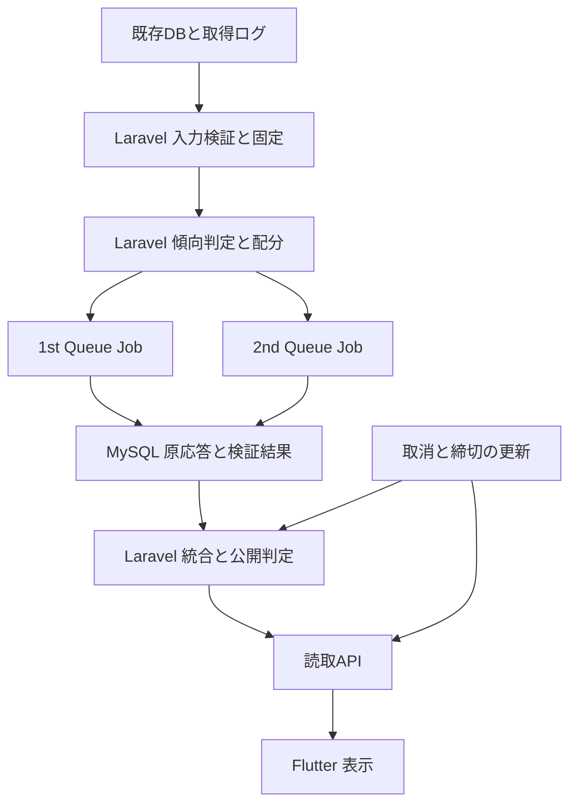

# 馬眼力 基本設計書

文書版：1.0  
作成日：2026年10月19日  
対象：2026年10月24日・25日の導入を目標とする r12.2  
実装構成：Laravel＋Flutter、既存MySQL、Laravel Queue

## 1 目的と採用方針

レース傾向に応じた人気帯別配分を守り、確認できる根拠を持つ人気薄を候補に残す経路を実装する。サーバー側で判定・配分・検証・保存・公開を完結させ、Flutterは検証済みの結果と現在の取消状態を表示する。

| 確認事項 | 今回採用する仕様 |
| --- | --- |
| ① X6 | **Bを採用**。過去類似成績によるX6は当面使用しない。既存仕様書9章の例外として暫定選出を許可する。N≧7ではX6=null、N＜7では既存定義のfalseを維持する。 |
| ② オッズ取得期限 | **6分前は予定時刻＋30秒、21・18・15・12・9分前は＋120秒**。発走時刻を基準とし、実際に受信・保存され利用可能になった時刻で検査する。 |
| ③ 暫定配分 | 不明信号がX6だけでmodeが一意にならない場合、**S0＝1はMIXED相当、S0＝3はVOLATILE相当**。正式modeはUNKNOWN、表示は暫定とする。 |
| 実装方式 | **Laravel＋Flutter**。追加の実行言語や外部計算プロセスを導入条件にしない。 |

暫定配分は選出方法の指定であり、レースが実際に混戦・波乱になると確定した意味ではない。判定不能だった33レースは暫定選出の対象になるが、入力不正・根拠不足・AI不正応答・期限超過は個別に検査する。

## 2 文書の役割と優先順位

| 文書 | 役割 |
| --- | --- |
| 変更計画書 文書版1.2 | 採用方針、変更範囲、工程、受入条件、33レースの配分表 |
| 本書 | システム構成、機能分担、処理の流れ、画面と運用の方針 |
| 詳細設計書 文書版1.0 | 項目、時刻式、判定手順、保存と競合、API、試験ケース |
| 既存r12.1仕様とプロンプト | 今回変更しない根拠・採点・局所訂正・順位・監査の契約 |

今回の実装構成・X6暫定規則・時刻契約・追加項目はこの文書セットを適用する。他の既存動作を独自に簡略化しない。旧版の保存済みsnapshotや応答は旧版のまま保持する。

本書は実装設計であり、実装完了報告ではない。詳細設計のクラス・新規テーブル名は今回の指定名で、既存システムに実在するとの意味ではない。既存DB列、サービス登録、キュー接続、認証方式、実AIの設定との対応は開発担当者が実コードで確認して記録する。

## 3 対象範囲

### 3.1 今回実装するもの

- 対象レース一覧を起点とする出馬表・オッズ・取消・締切の読込。
- 実取得時刻の監査と入力固定、X1〜X6・Zの判定、暫定配分。
- 人気帯配分と両AIの全頭独立評価、原応答保存、必要時の訂正。
- 根拠・採点・順位・候補の検証、保存済み応答からの統合。
- 取消と締切前倒し、期限内公開、公開後の取消表示。
- Flutter向け読取API、履歴、障害診断、取得データの保存。

### 3.2 今回有効にしないもの

| 機能 | 今回の扱い |
| --- | --- |
| X6の実履歴判定 | 未使用。定義・母数50件の数え方・検証・切替条件を別改訂で確定する。 |
| 学習による自動変更 | `learning_stage=COLLECT_ONLY`、`model_version=null`。記録を継続する。 |
| 購入推奨 | `buy_recommended=false`、`PENDING_VALIDATION`。公開候補の削除条件にはしない。 |
| 的中率・回収率の向上認定 | 今回の技術受入と区別し、開催後の照合で評価する。 |

## 4 全体構成

1stと2ndには同一snapshotを渡す。相手の回答や選出馬を入力に混ぜず、2ndも全N頭を評価する。AIへの外部通信中にDBの書込ロックを保持しない。

| 層 | 責務 |
| --- | --- |
| Laravelの入力層 | 正本の照合、取得期限、重複・欠損・取消矛盾、出典とcoverage |
| Laravelの計算層 | 正確な数値比較、信号、mode、配分、根拠検証、順位、局所回復 |
| Laravel Queue | 役割別AI呼出し、永続予約、訂正上限、統合の再実行 |
| MySQL | 凍結入力、取得監査、呼出枠、原応答、ライブ状態、公開履歴 |
| 読取API | 正式公開と現在状態の分離、表示用DTO、認証・認可 |
| Flutter | 暫定・不足・取消の表示。配分や候補の再計算はしない。 |

## 5 処理の流れ

### 5.1 入力の読込と固定

対象日とレース一覧を正本から確定する。出馬表やオッズが欠けてもレースを集計から落とさず、計算不能の理由を残す。宣言頭数、出馬表の馬番集合、取得したオッズの馬番集合を独立に照合する。

発走時刻をTとして、名目cutoffはT−360秒、入力の情報上限はT−330秒。6分前単勝は全活動馬分を同じ採用バッチで確保する。それ以外の欠損を理由に正常な馬を一律除外しない。

固定前に利用可能になった取消は出走集合へ反映する。固定後はsnapshot、順位、人気帯、信号、正式mode、配分用modeを変更せず、ライブ状態だけを更新する。

### 5.2 傾向と配分

通常の三値論理で可能なmodeが一つなら、そのmodeを採用する。複数modeにまたがり、不明がX6だけなら指定の暫定配分を使う。他の不明が原因でmodeがまたがる場合には例外を広げない。

人気帯は凍結単勝順位でA＝1〜6、B＝7〜10、D＝11以下。目標頭数はN＝1〜3ならN、4〜8なら4、9〜13なら5、14〜15なら6、16〜18なら7。配分の全表と不足時の順序は詳細設計書に固定する。

確認済み個別SIGNALが1系統ある馬を、旧資格・低配当・回収率・部分欠損だけで落とさない。有効な馬が帯内に足りれば指定枠を満たす。根拠が無い馬を数合わせで追加しない。

### 5.3 AIと統合

役割ごとに初回1回、必要な訂正1回まで、合計最大4呼出し。予約を永続保存してから外部APIへ送る。結果不明の呼出枠を再発行しない。

原応答の正常部分を保存し、不正箇所だけを隔離・訂正する。統合は保存済みの全適格馬順位を利用し、片側だけ有効でも期限内なら公開できる。正常な候補を旧候補フィルターへ戻さない。

### 5.4 公開と取消

公開期限は確認済み投票締切の60秒前、AI受領期限は公開期限の30秒前。取得猶予とは別に検査する。締切が前倒しされた場合は早い方を使い、延長で猶予を増やさない。

期限前の取消は保存済み全頭評価から再統合できる。期限後は取消表示だけを更新し、正式公開候補を追加・補充・入替しない。

## 6 画面とAPI

| 表示状態 | Flutterの表示 |
| --- | --- |
| CONFIRMED | 確定した傾向と候補。星は既存条件で確定できる場合だけ表示。 |
| PROVISIONAL | 「混戦として暫定選出」または「波乱として暫定選出」。過去類似判定が未確定と補足。星は表示しない。 |
| UNRESOLVED | 判定不能と理由。堅いレースへ読み替えない。 |
| 入力不足・期限超過 | 見送りと理由。候補を生成するための自動再取得・再AI送信を画面から行わない。 |
| 取消 | 正式公開時の履歴を残し、現在の取消状態を重ねて表示。 |

正式公開の識別子とライブ状態の版を別々に返す。取得完了時刻、正式公開時の頭数、現在頭数、不足理由も返す。原AI応答、予約token、内部認証情報は公開APIに出さない。

## 7 データ保存と運用

| データ | 保存方針 |
| --- | --- |
| 既存DBのオッズ等 | 元値を改変せず読む。必要な監査記録を新規テーブルへ保存する。 |
| snapshotと共通JSON | 版とhashを付け、不変保存する。 |
| AI原応答 | 完了状態、受領時刻、原文、出典hash、局所修復履歴を保持する。 |
| 公開結果 | 追記型の履歴とし、同一intentは同じ公開IDを返す。 |
| ライブ状態 | 取消集合、現在頭数、締切前倒し、revisionを管理する。 |
| 断層等の蓄積 | 週次洗い替え前に保存・照合する。成績を見て事前入力を書き換えない。 |

実時刻はタイムゾーン付きで管理し、比較は同一基準へ正規化する。画面は日本時間で表示する。数値の丸めや日時の推定補完で検査を通さない。

## 8 受入と導入

旧72レースの信号・Sの範囲・正式modeを維持し、確定39／暫定33になることを確認する。33レースでは同じ検証済み全頭評価を使い、比較側と採用側の候補・順序・根拠・不足理由を提出する。

| 日程 | 完了条件 |
| --- | --- |
| 10月20日 | 3文書を共有し、既存環境との対応、正本、担当工数を確認。読込3件・新契約の改修着手。 |
| 10月21日 | Laravel各処理を接続し、72件回帰と境界試験。 |
| 10月22日 | 33件比較、実AI18頭と訂正、Flutter、競合・再起動試験。 |
| 10月23日18時 | 既存AC01〜AC14を新契約へ更新した証跡と切戻し手順を提出。 |
| 10月24日 | 最初の選定2レースを非公開で通し、合格後に未凍結レースから段階導入。 |

この工程は担当工数と実試験で確認する目標である。技術的に未達なら機能フラグで新経路を停止し、固定済みレースを自動で旧AIへ再送しない。

## 9 実装者が追記する対応表

詳細設計書末尾の対応表に、既存クラス・テーブル列・キュー・実AI設定・画面ルート・試験結果を記録する。ここは環境への対応確認であり、①〜③を再び選択待ちにする欄ではない。設計書2本はMarkdownのまま実装差分と同時に更新する。

参照：変更計画書 文書版1.2、r12.1実装仕様書20261017、引継ぎ確認事項更新版、提出2026-10-19_07のrev.30とv8、同提出分の確認結果。
